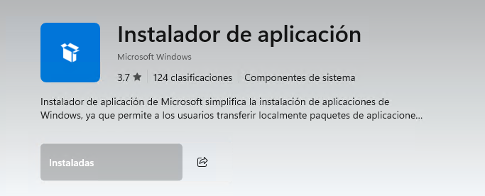

## Instalación de openGL en windows 11

## VS Code

## Dependencias de OpenGL

### MSYS2

Gestor de paquetes

[Software Distribution and Building Platform for Windows](https://www.msys2.org/)

### dependencias de openGL

## GIT

## Winget

Como ya se cuenta con la microsoft store

```powershell
ms-windows-store://pdp/?ProductId=9NBLGGH4NNS1
```


