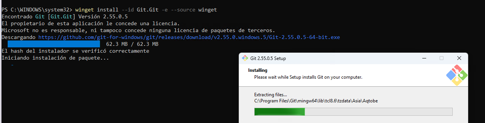
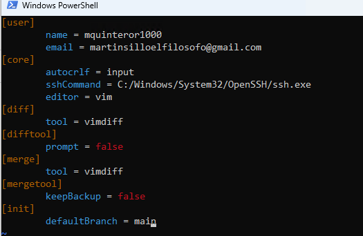

## Instalación de openGL en windows 11

## VS Code

## Dependencias de OpenGL

### MSYS2

Gestor de paquetes

[Software Distribution and Building Platform for Windows](https://www.msys2.org/)

### dependencias de openGL

```powershell
pacman -Syu
pacman -S --needed base-devel mingw-w64-ucrt-x86_64-toolchain
```

Se instalan todos los paquetes (default: all)

```bash
1) mingw-w64-ucrt-x86_64-binutils  2) mingw-w64-ucrt-x86_64-crt  3) mingw-w64-ucrt-x86_64-gcc
4) mingw-w64-ucrt-x86_64-gdb  5) mingw-w64-ucrt-x86_64-gdb-multiarch
6) mingw-w64-ucrt-x86_64-headers  7) mingw-w64-ucrt-x86_64-libgomp
8) mingw-w64-ucrt-x86_64-libstdc++  9) mingw-w64-ucrt-x86_64-libwinpthread
10) mingw-w64-ucrt-x86_64-make  11) mingw-w64-ucrt-x86_64-pkgconf
12) mingw-w64-ucrt-x86_64-winpthreads
```

Agregar PATH

```powershell
C:\msys64\ucrt64\bin
```

Verificar

```powershell
PS C:\Users\martin> g++ --version
g++.exe (Rev6, Built by MSYS2 project) 16.2.0
Copyright (C) 2026 Free Software Foundation, Inc.
This is free software; see the source for copying conditions.  There is NO
warranty; not even for MERCHANTABILITY or FITNESS FOR A PARTICULAR PURPOSE.
```

[Configurar primer proyecto](primer-proyecto.md)

## GIT

## Winget

Como ya se cuenta con la microsoft store

```powershell
ms-windows-store://pdp/?ProductId=9NBLGGH4NNS1
```


#### git usando winget

en la powershell

```powershell
winget install --id Git.Git -e --source winget
```



```powershell
PS C:\Users\martin> git --version
git version 2.55.0.windows.5
```

Configuracion de git

```powershell
git config --global user.name "mquinteror1000"
git config --global user.email "mymail@gmail.com"
git config --list
```

### Configurar acceso mediante claves ssh

Como w11 trae consigo el cliente openssh, la configuración es similar a linux

En ~/.ssh/config

```bash
Host rocky3
    HostName 192.168.122.151
    User martin
    IdentityFile ~/.ssh/mquinteror1000
    Port 22

Host github.com
    HostName github.com
    User git
    IdentityFile ~/.ssh/mquinteror1000
```

cambiar los permisos a la clave

```powershell
icacls ~\.ssh\mquinteror1000 /inheritance:r
icacls ~\.ssh\mquinteror1000 /grant:r "$($env:USERNAME):(R)"
```

probar

```powershell
PS C:\Users\martin\.ssh> ssh -T git@github.com
Hi mquinteror1000! You've successfully authenticated, but GitHub does not provide shell access.
PS C:\Users\martin\.ssh>
```

Ya podemos versionar nuestras opengl cositas

Configuraciones recomendadas de git

```powershell
git config --global core.autocrlf input
git config --global core.sshCommand "C:/Windows/System32/OpenSSH/ssh.exe"
git config --global core.editor "vim"
git config --global diff.tool vimdiff
git config --global difftool.prompt false
git config --global merge.tool vimdiff
git config --global mergetool.keepBackup false

```

verificado y de una vez agregada la branch por default

```powershell
git config --global --edit
```




